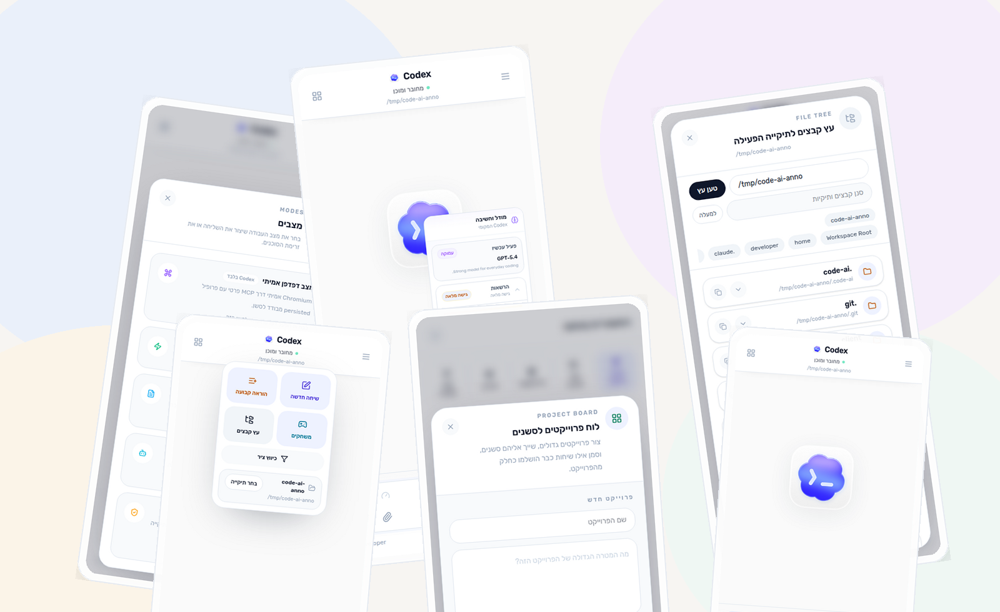
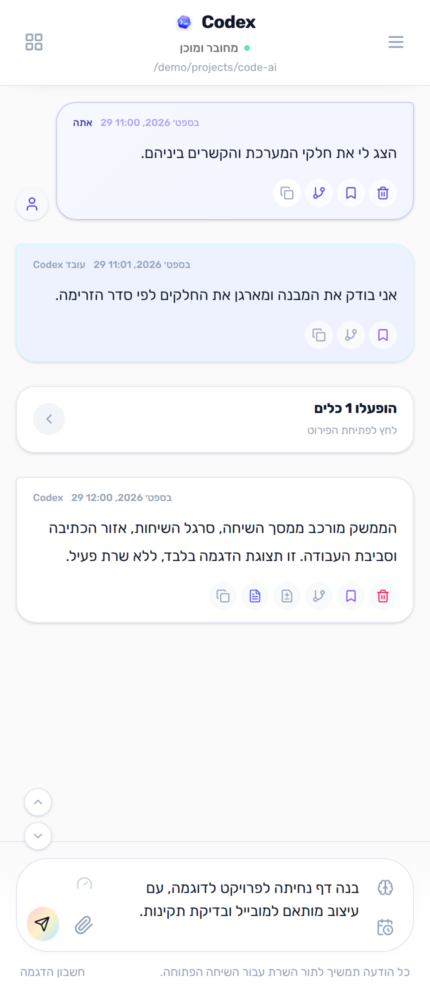
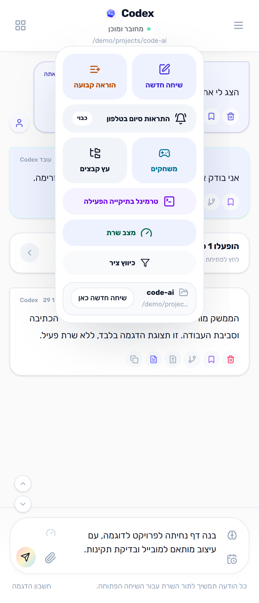
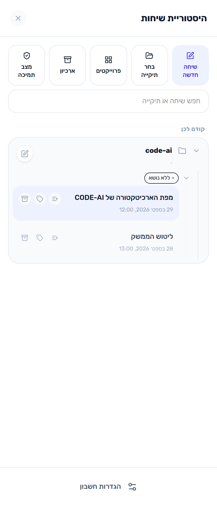
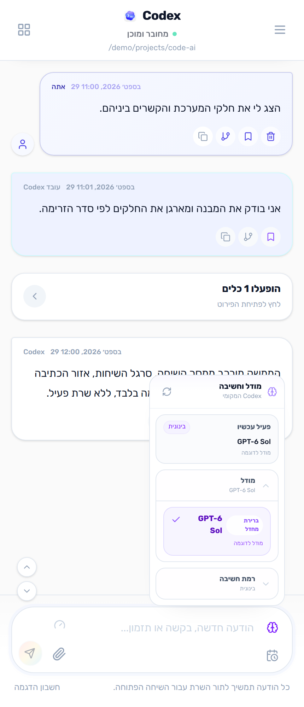
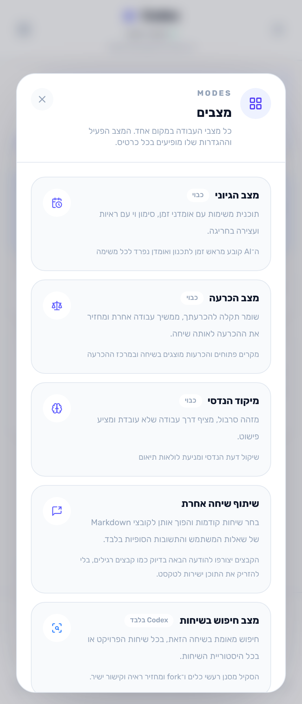
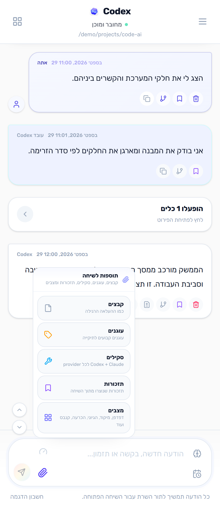
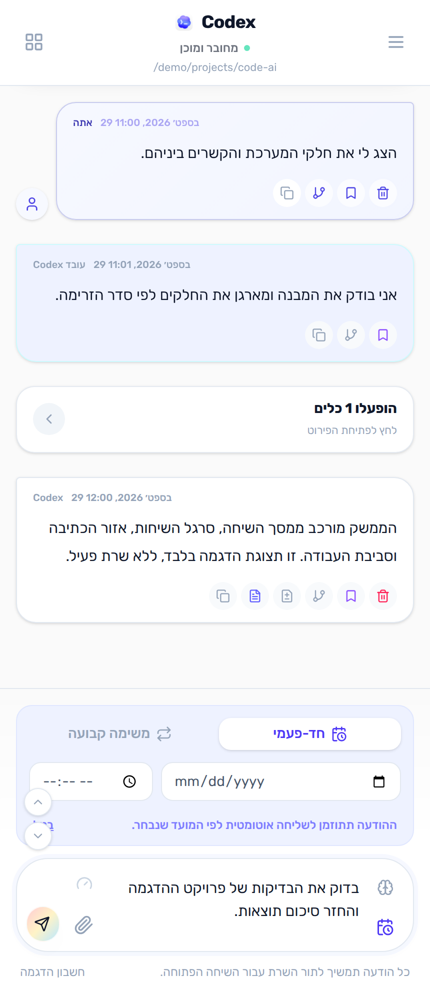

<div dir="rtl">

# Code AI

### סביבת עבודה לסוכני קוד — מהמחשב ומהטלפון

**קוד פתוח ברישיון [MIT](LICENSE).**

**Codex, Claude Code ו־Gemini CLI בממשק אחד בעברית.** מנהלים שיחות, קבצים, תורי משימות ותזמון דרך הדפדפן, בזמן שסוכני הקוד עובדים על המחשב או השרת שלכם.

<p align="center">
  
</p>

Code AI פועלת מעל כלי שורת הפקודה של הספקים. היא משתמשת בחשבונות ובתיקיות העבודה שהגדרתם, ומרכזת את ניהול העבודה במסך שמתאים גם למובייל. אפשר להתחיל עם ספק אחד ולהוסיף אחרים בהמשך.

## מה אפשר לעשות

| יכולת | איך היא עוזרת בעבודה |
| --- | --- |
| שלושה ספקי AI | בחירת פרופיל של Codex, Claude Code או Gemini CLI, עם תיקיית עבודה ובית ספק נפרדים. |
| שיחות והיסטוריה | המשך שיחה, חיפוש, נושאים, ארכיון, הסתעפות והעברה בין ספקים. |
| תור משימות וטיוטות | שליחת משימות להמשך השיחה, שמירת טיוטות ומעקב אחרי עבודה ממתינה ופעילה. |
| תזמון | הכנת הודעה להפעלה מאוחרת או למשימה חוזרת. |
| קבצים והקשר | צירוף קבצים ותמונות, עוגנים, סקילים ותזכורות, לצד עץ קבצים ותצוגות מקדימות. |
| טרמינל | פתיחת טרמינל בתיקיית העבודה הפעילה מתוך הממשק. |
| מודלים והרשאות | בחירת מודל, רמת חשיבה והגדרות ריצה בהתאם ליכולות הספק. |
| פרויקטים | ארגון שיחות ומשימות משנה סביב פרויקט משותף. |
| התראות סיום | קבלת עדכון לטלפון כאשר הוגדר שירות התראות בחיבור שלכם. |
| כמה מחשבים ושרתים | מעבר בין סביבת העבודה המקומית למחשבים שחוברו למערכת. |

## סיור בממשק

הצילומים מציגים את הממשק המקורי עם **נתוני הדגמה בלבד**. השמות, השיחות ונתיבי העבודה שמופיעים בהם הם דוגמאות. האפשרויות הזמינות בפועל תלויות בספק ובחיבורים שהוגדרו.

### שיחה ופעולות מהירות

<p align="center">
  
  
</p>

מסך השיחה מרכז את ההודעות, פעולות הכלים ואזור הכתיבה. תפריט הפעולות נותן גישה מהירה לשיחה חדשה, הוראה קבועה, התראות סיום, עץ הקבצים, טרמינל ומצב השרת — כמו בתצוגת המובייל.

### היסטוריה, מודלים והגדרות ריצה

<p align="center">
  
  
</p>

אפשר לחזור לשיחה קודמת, לעבור בין פרופילים ולארגן שיחות לפי נושאים. פאנל המודל מרכז את אפשרויות הריצה של הספק הפעיל; שמות המודלים והאפשרויות משתנים לפי החשבון והתקנת ה־CLI.

### מצבי עבודה, הקשר ותזמון

<p align="center">
  
  
  
</p>

מצבי העבודה מוסיפים כלים לתכנון, ביצוע ובקרה. בין האפשרויות, בהתאם לספק:

- **מצב הגיוני** — תוכנית משימות עם אומדני זמן ומעקב אחר השלמה.
- **מצב הכרעה** — ריכוז שאלות ותקלות שדורשות החלטה של המשתמש.
- **מיקוד הנדסי** — בחינת דרך העבודה והצעת פישוט כשנוצר סרבול.
- **מצב מקצועי וביאורים** — שלבי תכנון, ביצוע ובדיקה, או הסבר מסודר לאחר העבודה.
- **מפות זרימה** — הצגת רכיבי מערכת והקשרים ביניהם במפה ניתנת לעריכה.
- **עיצוב וחוויית משתמש** — מצבי ייעוץ ייעודיים עם Gemini מתוך שיחת Codex.
- **הגבלת פעולה** — הגדרת הקבצים או התיקיות שבהם מתמקדת המשימה.

### חיבור לדפדפן ולמכשירים

- **דפדפן מבודד** מאפשר עבודה עם Chromium דרך כלי ניווט, קריאת עמודים, לחיצות וצילומי מסך.
- **Chrome אישי** מחבר תוסף לדפדפן במחשב שלכם, עם שיוך לסשן והגדרות הרשאה. [הוראות התוסף](chrome-extension/README.md).
- **מצב טלפון** מחבר מכשיר Android באמצעות שירות Reapre שהוגדר בנפרד.

## איך זה עובד

הממשק בדפדפן פונה לשרת Code AI. השרת מנהל את התור ומפעיל את כלי שורת הפקודה של הספק שנבחר, בתוך תיקיית העבודה שהוגדרה. התשובות, פעולות הכלים ומצב המשימות מוצגים בשיחה.

היסטוריית הספקים נשארת בתיקיות הנתונים שלהם. Code AI שומרת בנפרד מידע שהיא מנהלת, כמו תורים, כותרות, נושאים וקבצים מצורפים. חשבונות הספקים ועלויות השימוש בהם מוגדרים בנפרד מהמערכת.

## התחלה מהירה

### דרישות

- Node.js בגרסה 20 ומעלה, npm ו־Git.
- לפחות אחד מכלי שורת הפקודה: Codex CLI, Claude Code או Gemini CLI, מותקן ומחובר לחשבון.
- PM2 לניהול תהליך השרת.
- Python 3 אם משתמשים במצב הדפדפן המבודד.

### הורדת הקוד

</div>

```bash
git clone https://github.com/binacshera-ui/code-ai.git
cd code-ai
npm install --global pm2
node deploy/code-ai/install.mjs --help
```

<div dir="rtl">

### התקנה ב־Linux או macOS

החליפו את נתיב הפרויקט ואת שני ערכי האבטחה בדוגמה. `--codex-home` צריך להצביע לתיקיית הנתונים של התקנת Codex שלכם.

</div>

```bash
node deploy/code-ai/install.mjs \
  --app-name code-ai-app \
  --port 4000 \
  --codex-home "$HOME/.codex" \
  --workspace "/path/to/your/project" \
  --device-password "REPLACE_WITH_YOUR_UNIQUE_PASSWORD" \
  --session-secret "REPLACE_WITH_A_LONG_RANDOM_SECRET"
```

<div dir="rtl">

### התקנה ב־Windows PowerShell

</div>

```powershell
node deploy/code-ai/install.mjs `
  --app-name code-ai-app `
  --port 4000 `
  --codex-home "$env:USERPROFILE\.codex" `
  --workspace "C:\workspace\my-project" `
  --device-password "REPLACE_WITH_YOUR_UNIQUE_PASSWORD" `
  --session-secret "REPLACE_WITH_A_LONG_RANDOM_SECRET"
```

<div dir="rtl">

המתקין מכין את קובץ הסביבה, מתקין תלויות, בונה את הלקוח והשרת ומגדיר את תהליך PM2. כברירת מחדל הוא מכין גם את סביבת Python ו־Chromium; אפשר לדלג על שלב הדפדפן עם `--skip-browser-setup`.

בסיום פותחים את `http://localhost:4000/chat` ונכנסים באמצעות סיסמת המכשיר שהוגדרה. לגישה מרחוק יש להגדיר כתובת HTTPS ואימות מתאימים לסביבת ההתקנה.

### הגדרת ספקים ופרופילים

המשתנה `CODEX_PROFILES_JSON` מאפשר להגדיר כמה פרופילים. בכל פרופיל מגדירים:

| שדה | משמעות |
| --- | --- |
| `id` | מזהה ייחודי לפרופיל. |
| `label` | השם שיוצג בממשק. |
| `provider` | אחד מהערכים `codex`, `claude` או `gemini`. |
| `codexHome` | תיקיית הנתונים של הספק. השם נשמר לצורכי תאימות ומשמש את כל שלושת הספקים. |
| `workspaceCwd` | תיקיית העבודה עבור שיחות חדשות. |
| `defaultProfile` | האם הפרופיל ייבחר כברירת מחדל. |

דוגמאות לכל שלושת הספקים והגדרות האחסון נמצאות ב־[קובץ הסביבה לדוגמה](.env.example). הגדרות אישיות וסודות נשמרים בקובץ `.env` המקומי.

## פיתוח והשתתפות

הלקוח כתוב ב־**React, TypeScript ו־Vite**, והשרת ב־**Node.js ו־Express**. חלק מהכלים משלבים Python ותהליכי CLI מקומיים.

| תיקייה | תוכן |
| --- | --- |
| `client/` | הממשק, מסכי השיחה ורכיבי התצוגה. |
| `server/` | API, תורים, חיבורי ספקים וניהול סשנים. |
| `shared/` | טיפוסים וחוזים משותפים ללקוח ולשרת. |
| `chrome-extension/` | תוסף Chrome אישי. |
| `deploy/code-ai/` | המתקין, כלי הייצוא ותמונות התיעוד. |
| `scripts/` | כלי עזר ובדיקות. |

פקודות בסיס לפיתוח:

</div>

```bash
npm install --include=dev
npm run dev
npm run build
```

<div dir="rtl">

`npm run dev` מפעילה את ממשק הפיתוח; בקשות ה־API מופנות לשרת המקומי בפורט 4000. `npm run build` בונה את הלקוח והשרת. רשימת הבדיקות הממוקדות נמצאת ב־[package.json](package.json).

אפשר לפתוח [דיווח על תקלה או בקשת שיפור](https://github.com/binacshera-ui/code-ai/issues), או לשלוח Pull Request עם תיאור השינוי ואופן הבדיקה. לצורך דיווח מצרפים דוגמה נקייה מפרטי חשבונות, סודות ותוכן שיחות אישי.

### רישיון

הפרויקט מופץ ברישיון [MIT](LICENSE). אפשר להשתמש בקוד, לשנות אותו ולהפיץ אותו, גם לצרכים מסחריים, בכפוף לשמירת הודעת זכויות היוצרים ונוסח הרישיון. התוכנה מסופקת כפי שהיא, ללא אחריות, כמפורט ברישיון.

לתלויות ולרכיבי צד שלישי חלים הרישיונות שלהם.

</div>
